# ⚡ Awesome-Terminal-Multiplexers 🖥️

  

  
  
  
  
  
  
  

---

## 🧭 Overview & Ecosystem Introduction

Welcome to **Awesome-Terminal-Multiplexers** — the definitive curated directory of **Terminal Multiplexers, Workspace Orchestrators, Session Persistence Engines, and Commercial Remote Connection Managers**.

A **terminal multiplexer** is an indispensable tool in developer ergonomics and system administration. It bridges interactive shell sessions and persistent background daemon processes, allowing engineers to:
- 🛡️ **Survive SSH Disconnections:** Detach from a remote server without killing long-running builds, database migrations, or scripts, and reattach seamlessly later.
- 🪟 **Master Grid & Split Panes:** Divide a single terminal window into multiple horizontal and vertical panes, floating widgets, and tabs.
- 🔄 **Orchestrate Multi-Task Workflows:** Manage multiple command-line services side-by-side using declarative YAML/JSON templates.
- 🤝 **Enable Live Pair Programming:** Share live TUI sessions across local networks or remote machines with colleagues.

Whether you rely on classic workhorses like **tmux** and **GNU Screen**, modern Rust-powered engines like **Zellij** and **WezTerm**, or enterprise SSH workstations like **Termius** and **Devolutions RDM**, this guide indexes the entire landscape.

---

## 📑 Table of Contents

- [⚡ Awesome-Terminal-Multiplexers 🖥️](#️-awesome-terminal-multiplexers-️)
  - [🧭 Overview \& Ecosystem Introduction](#-overview--ecosystem-introduction)
  - [📑 Table of Contents](#-table-of-contents)
  - [📊 Sector Overview \& Market Dynamics](#-sector-overview--market-dynamics)
  - [🏢 SaaS \& Commercial Remote Session Platforms](#-saas--commercial-remote-session-platforms)
  - [🐙 Open-Source GitHub Projects (Ranked by Stars)](#-open-source-github-projects-ranked-by-stars)
    - [👑 Top-Tier Terminal Multiplexers \& Workspaces](#-top-tier-terminal-multiplexers--workspaces)
    - [🧩 Session Managers, Automations \& Companion Tools](#-session-managers-automations--companion-tools)
    - [🏛️ Foundational \& Niche Multiplexers](#️-foundational--niche-multiplexers)
  - [🔍 Feature Comparison Matrix](#-feature-comparison-matrix)
  - [🤝 How to Contribute](#-how-to-contribute)
  - [📈 Star History](#-star-history)
  - [💖 Support \& Sponsoring](#-support--sponsoring)
  - [⚠️ Disclaimer](#️-disclaimer)

---

## 📊 Sector Overview & Market Dynamics

The global market for terminal emulation, remote access, and developer command-line workspace infrastructure is estimated at approximately **$2.8 billion to $3.5 billion**, expanding at a steady CAGR of ~7.2% driven by accelerated cloud-native deployments, distributed engineering teams, and remote infrastructure administration.

Unlike enterprise cloud infrastructure, the terminal multiplexer and developer session management sector is **moderately to highly fragmented** rather than a winner-take-all monopoly:
- **In Open-Source:** `tmux` remains the battle-tested standard across Linux distributions and legacy bastions, yet strong community migration is actively distributing adoption toward next-generation alternatives such as `Zellij` (Rust-based discoverability), `WezTerm` (GPU-accelerated multiplexing), and `Ghostty`.
- **In SaaS & Commercial Workstations:** No single commercial vendor commands a dominant monopoly. Instead, the market is divided among specialized use cases: **Warp** captures AI-assisted cloud terminal workflows; **Devolutions RDM** and **Royal TS** dominate multi-protocol enterprise sysadmin infrastructure (SSH/RDP/VNC); **Termius** excels in cross-device mobile/desktop synchronization; and **SecureCRT** retains entrenched B2B compliance and government contracts.

---

## 🏢 SaaS & Commercial Remote Session Platforms

Commercial session platforms augment terminal workflows with cloud credential vaults, cross-device synchronization, hardware acceleration, team role-based access, and enterprise audit logging.

> **Sorted by Company Size / Scale (Valuation / Revenue Descending)**

| Product / Platform | Company Size & Scale | Starting Tier Price | Free Tier Limits | Key Multiplexing & Session Capabilities |
| :--- | :--- | :--- | :--- | :--- |
| **[Warp](https://warp.dev/)** | **~$200M Valuation** *(~$16M ARR, $75M VC raised)* | **$20/month** *(or $18/mo billed annually for Build Plan)* | **Free forever plan ($0/mo)**: Includes core terminal emulator, split panes, and Warp Agent CLI; **0 bundled monthly AI credits** (requires BYOK API key or pay-as-you-go credits); capped cloud conversation storage. | Modern GPU-accelerated terminal with native split panes, mouse-driven pane resizing, AI-assisted shell completions, and collaborative cloud workflows. |
| **[Devolutions RDM](https://devolutions.net/remote-desktop-manager/)** | **~$33M ARR** *(~$200M+ implied valuation, bootstrapped, 200+ employees)* | **$30/user/month** *(billed annually at $360/user/yr for Team Edition)* | **Free forever Solo Edition**: Permitted for 1 user on a single workstation; **0 shared team vaults**, 0 shared data sources, 0 centralized credentials, and community forum support only. | Enterprise connection & multi-session orchestrator supporting embedded tabbed SSH, telnet, RDP, VNC, and centralized privileged access management. |
| **[Termius](https://termius.com/)** | **~$4M ARR** *(~$15M–$20M valuation, YC & Initialized-backed)* | **$10/user/month** *(billed annually at $120/yr for Pro Plan; or $12/mo monthly)* | **Free forever Starter Plan**: Restricted strictly to **1 local vault on 1 device**; **0 cross-device cloud sync** across desktop/mobile, 0 shared team vaults, and 0 port forwarding profiles. | Cross-platform SSH client with terminal tabs, multi-exec command broadcast, Mosh support, SFTP browser, and end-to-end encrypted credential sync. |
| **[SecureCRT](https://www.vandyke.com/)** | **~$2.5M–$5M ARR** *(Est. 25–40 employees, privately held since 1995)* | **$119.00 perpetual** *(per single-user license, includes 1 year updates & support; $190 for 3 years)* | **30-day free evaluation trial**: Fully functional across Windows, macOS, and Linux for **exactly 30 calendar days**; license expires and software ceases operation without a purchased key. | Rock-solid commercial terminal emulator with multi-session tabbed SSH2/Telnet/Serial connections, scriptable session automation, and FIPS 140-2 compliance. |
| **[MobaXterm](https://mobaxterm.mobatek.net/)** | **~$2M–$4M ARR** *(Privately held French software vendor)* | **$69.00 perpetual** *(€49 per user license, includes 12 months updates & maintenance)* | **Free forever Home Edition**: Enforces a hard limit of **maximum 12 saved sessions**, **max 2 SSH tunnels**, **max 4 macros**, and network daemons capped at a **360-second runtime limit**. | All-in-one Windows toolbox featuring tabbed SSH multiplexing, embedded X11 server, split terminal grid, and simultaneous multi-terminal command execution. |
| **[Royal TS](https://www.royalapps.com/)** | **~$1M–$2M ARR** *(code4ward / Royalapps, privately held Austrian ISV)* | **$79.00 perpetual** *(€59 per individual user license, includes 1 year software maintenance)* | **Free forever Shareware Mode**: Hard limit of **maximum 10 connections**, **max 10 credentials**, and **only 1 open document/workspace** per running instance. | Multi-protocol remote management workstation for Windows & macOS featuring tabbed SSH terminals, credential inheritance, and multi-session grouping. |

---

## 🐙 Open-Source GitHub Projects (Ranked by Stars)

Every major open-source terminal multiplexer, tiling emulator with native multiplexing, session persister, and automation framework — **sorted strictly by GitHub stargazers (descending)**.

### 👑 Top-Tier Terminal Multiplexers & Workspaces

1. **[Tabby](https://github.com/Eugeny/tabby)**   
   *An infinitely customizable cross-platform terminal app with built-in pane multiplexing, SSH client, and serial connection manager.*  
   - **Features:** Split panes, tabs, integrated SFTP client, persistent profiles, and complete color scheme ecosystem.  
   - **Tech:** TypeScript / Electron • **License:** MIT

2. **[Ghostty](https://github.com/ghostty-org/ghostty)**   
   *Fast, feature-rich, GPU-accelerated terminal emulator designed by Mitchell Hashimoto with native tabs and split pane multiplexing.*  
   - **Features:** Native platform UI, lightning-fast rendering, multi-pane layouts, inspector tools, and modern shell integration.  
   - **Tech:** Zig • **License:** MIT

3. **[tmux](https://github.com/tmux/tmux)**   
   *The gold standard terminal multiplexer — enables persistent detached sessions, window management, and scriptable split panes.*  
   - **Features:** Client-server daemon architecture, detach/attach workflows, custom prefix keybindings (`Ctrl-b`), and vast plugin ecosystem.  
   - **Tech:** C • **License:** ISC / BSD

4. **[Zellij](https://github.com/zellij-org/zellij)**   
   *A modern, batteries-included terminal workspace with discoverable keyboard shortcuts, floating panes, and WebAssembly plugin system.*  
   - **Features:** On-screen discoverable status bar shortcuts, draggable pane dividers, session resurrection, layout presets, and WebAssembly plugin API.  
   - **Tech:** Rust • **License:** MIT

5. **[Kitty](https://github.com/kovidgoyal/kitty)**   
   *Fast, feature-dense, GPU-based terminal emulator with native window tiling, tab management, and sessions.*  
   - **Features:** GPU rendering via OpenGL, native splits (horizontal, vertical, stack, grid), kitten extensions, and image protocol.  
   - **Tech:** C & Python • **License:** GPL-3.0

6. **[WezTerm](https://github.com/wezterm/wezterm)**   
   *GPU-accelerated cross-platform terminal emulator and multiplexer written in Rust with Lua configuration.*  
   - **Features:** Built-in terminal multiplexer (no separate tmux required), SSH domains, serial ports, tabs, panes, and ligature rendering.  
   - **Tech:** Rust / Lua • **License:** MIT

7. **[Wave Terminal](https://github.com/wavetermdev/waveterm)**   
   *Open-source, AI-native terminal workspace with persistent sessions, graphical widgets, and file previews.*  
   - **Features:** Inline graphical rendering, persistent workspaces across reboots, remote SSH workspace preservation, and web previews.  
   - **Tech:** Go & TypeScript • **License:** Apache-2.0

8. **[iTerm2](https://github.com/gnachman/iTerm2)**   
   *The premier macOS terminal emulator with deep native tmux integration and pane splitting.*  
   - **Features:** Native tmux gateway mode (`tmux -CC`), split panes, instant replay, trigger automations, and inline image support.  
   - **Tech:** Objective-C • **License:** GPL-2.0

9. **[Tilix](https://github.com/gnunn1/tilix)**   
   *Advanced GTK3 tiling terminal emulator for Linux following GNOME Human Interface Guidelines.*  
   - **Features:** Drag-and-drop pane reordering, synchronized input across terminals, custom titles, and sidebar session profiles.  
   - **Tech:** D • **License:** MPL-2.0

10. **[Terminator](https://github.com/gnome-terminator/terminator)**   
    *The original grid-based tiling terminal emulator for Linux/X11.*  
    - **Features:** Infinite grid splitting, tab support, drag-and-drop layout configuration, and broadcast typing across groups.  
    - **Tech:** Python / GTK • **License:** GPL-2.0

11. **[Byobu](https://github.com/dustinkirkland/byobu)**   
    *Text-based window manager and terminal multiplexer wrapper for tmux and GNU Screen.*  
    - **Features:** Intuitive function-key shortcuts (F2 new, F3/F4 switch), live hardware telemetry monitoring in status bar, and simplified setup.  
    - **Tech:** Shell / Python • **License:** GPL-3.0

12. **[abduco](https://github.com/martanne/abduco)**   
    *Clean session management tool providing detach and attach capabilities for any arbitrary command.*  
    - **Features:** Session persistence without terminal emulation overhead, zero dependencies, often paired with `dvtm`.  
    - **Tech:** C • **License:** ISC

13. **[dvtm](https://github.com/martanne/dvtm)**   
    *Dynamic virtual terminal manager bringing dwm-style tiling window management to the console.*  
    - **Features:** Tiling layouts for CLI applications, minimal memory footprint, keyboard-driven navigation, and seamless abduco pairing.  
    - **Tech:** C • **License:** ISC

14. **[cy](https://github.com/cfoust/cy)**   
    *A time-traveling, scriptable terminal multiplexer focused on replaying, recording, and searching terminal history.*  
    - **Features:** Built-in rewindable history recorder, fuzzy search across all panes, and Janet scripting configuration.  
    - **Tech:** Go / Janet • **License:** MIT

15. **[Magmux](https://github.com/MadAppGang/magmux)**   
    *Headless terminal multiplexer designed specifically for AI agents, CI pipelines, and automated harnesses.*  
    - **Features:** Socket-driven headless control without a TTY, 1000-line scrollback buffer, VT-100 emulation, and split panes.  
    - **Tech:** Go • **License:** MIT

---

### 🧩 Session Managers, Automations & Companion Tools

These companion utilities supercharge tmux and terminal multiplexers with automated layout restores, session managers, and multi-pane broadcast dispatchers:

1. **[Oh My Tmux!](https://github.com/gpakosz/.tmux)**   
   *Self-contained, beautiful, and powerline-styled `.tmux.conf` configuration with battery, CPU, and network indicators.*

2. **[Tmux Plugin Manager (TPM)](https://github.com/tmux-plugins/tpm)**   
   *The official package manager for tmux plugins — effortlessly install, update, and manage tmux extensions.*

3. **[Tmuxinator](https://github.com/tmuxinator/tmuxinator)**   
   *Manage complex tmux sessions using declarative YAML project definitions to boot windows, panes, and services at once.*

4. **[tmux-resurrect](https://github.com/tmux-plugins/tmux-resurrect)**   
   *Restore tmux environments across system reboots — saves pane layouts, shell history, running programs (vim, htop), and active directories.*

5. **[tmuxp](https://github.com/tmux-python/tmuxp)**   
   *Python-powered tmux session manager and automation library supporting YAML/JSON session configurations.*

6. **[tmux-continuum](https://github.com/tmux-plugins/tmux-continuum)**   
   *Continuous automatic saving and restoring of tmux sessions every 15 minutes, with automatic server resurrection on boot.*

7. **[tmux-xpanes](https://github.com/greymd/tmux-xpanes)**   
   *Awesome tmux-based multi-pane command-line dispatcher — opens multiple synchronized panes and broadcasts commands simultaneously.*

---

### 🏛️ Foundational & Niche Multiplexers

- **[GNU Screen](https://www.gnu.org/software/screen/)**  
  *The pioneer of terminal multiplexing.* Pre-installed on virtually every POSIX-compliant UNIX and Linux distribution since 1987. Uses `Ctrl-a` prefix key bindings. Ideal for rescue disks, legacy servers, and minimal embedded systems where tmux is unavailable.
- **[BDH Terminal Engine](https://pypi.org/project/bdh-terminal-engine/)**  
  *Pure C lightweight terminal engine and modal multiplexer.* Features zero GUI dependencies, concurrent session handling, built-in URL/IP token scanner, and integrated ASCII web browsing via `links`.

---

## 🔍 Feature Comparison Matrix

| Tool | Persistent Detach/Attach | Native Splits | GPU Accelerated | Mouse Friendly | Configuration Language | Plugin Ecosystem |
| :--- | :---: | :---: | :---: | :---: | :--- | :--- |
| **tmux** | ✅ Yes | ✅ Yes | ❌ No (CPU) | ⚙️ Configurable | `.tmux.conf` / Shell | Extensive (TPM) |
| **Zellij** | ✅ Yes | ✅ Yes | ❌ No (CPU) | ✅ Built-in | KDL / Rust | WebAssembly (WASM) |
| **WezTerm** | ✅ Yes (SSH Domains) | ✅ Yes | ✅ Yes (OpenGL/Vulkan) | ✅ Built-in | Lua | Lua scripts |
| **Ghostty** | ❌ (Emulator level) | ✅ Yes | ✅ Yes (Metal/OpenGL) | ✅ Built-in | Key-value config | Custom extensions |
| **Tabby** | ❌ (Emulator level) | ✅ Yes | ✅ Yes (WebGL) | ✅ Built-in | GUI / YAML | NPM / JS Plugins |
| **GNU Screen** | ✅ Yes | ⚙️ Basic | ❌ No (CPU) | ❌ Keyboard only | `.screenrc` | None |
| **abduco + dvtm**| ✅ Yes (via abduco) | ✅ Yes (via dvtm) | ❌ No (CPU) | ⚙️ Limited | `config.h` (C) | Minimal / C patches |

---

## 🤝 How to Contribute

We welcome community contributions, tool additions, and documentation enhancements! 🚀

1. 🍴 **Fork** this repository.
2. 🌿 Create a feature branch: `git checkout -b feature/add-new-multiplexer`.
3. 📝 Update `README.md` following the established table / list format:
   - Provide clean documentation, official repository/website links.
   - For SaaS products, verify specific starting prices and exact free tier limitations.
   - For open-source tools, include the stargazers badge: ``.
4. 📬 Submit a Pull Request with a descriptive summary of your changes.

---

## 📈 Star History

---

## 💖 Support & Sponsoring

A huge thank you to all contributors, maintainers, and community members who make the terminal workspace and open-source ecosystem thrive! 🌟

If this curated directory has improved your terminal workflow or helped you discover your favorite multiplexer:
- ⭐ **Star this repository** to help others in the developer community find it.
- 🍴 **Fork and contribute** new tools, plugin discoveries, or improvements.
- 📢 **Share** the list with sysadmins, DevOps teams, and terminal enthusiasts.
- ☕ **Buy a coffee & sponsor ongoing maintenance** via the [GitHub Sponsor Dashboard](https://github.com/sponsors/ishandutta2007).

  

---

## ⚠️ Disclaimer

- This curated list is maintained for educational and reference purposes by the open-source community and is not an endorsement of any commercial platform.
- Terminal multiplexers and remote connection tools vary considerably in architectural design, memory footprint, and security posture. Ensure proper key management, SSH hardening, and session timeouts when deploying on production servers.

---

  Maintained with ❤️ by <a href="https://github.com/ishandutta2007">Ishan Dutta</a> and the global open-source community.

